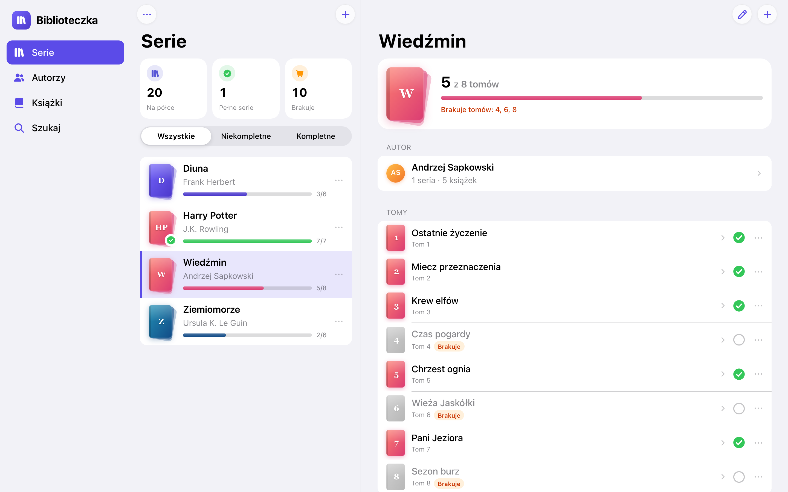
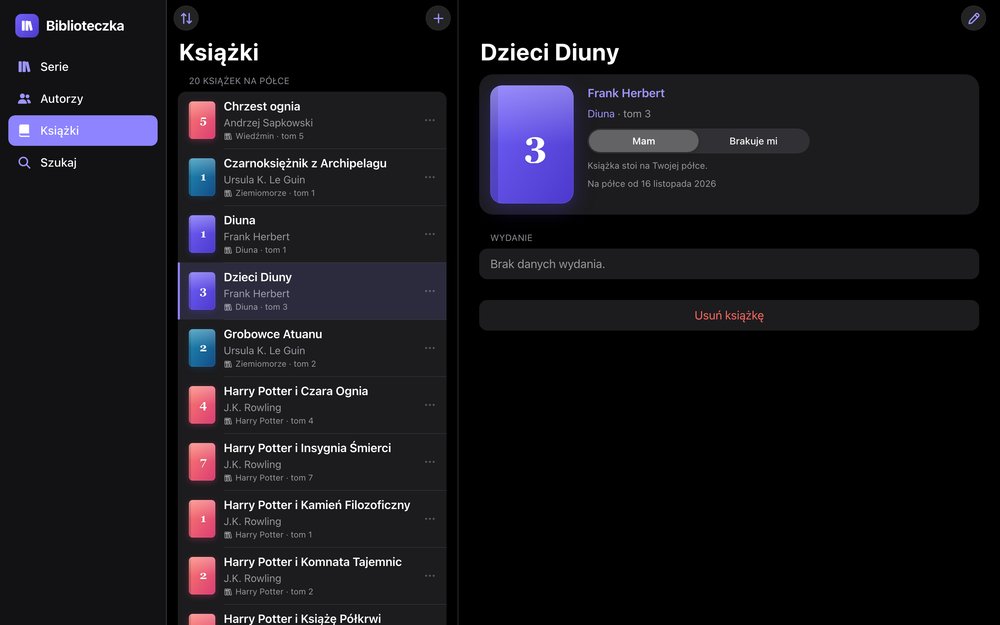
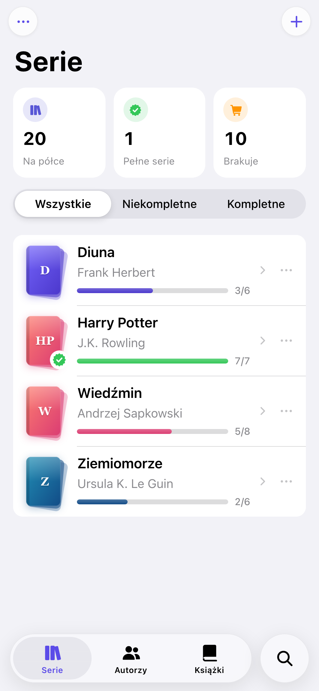
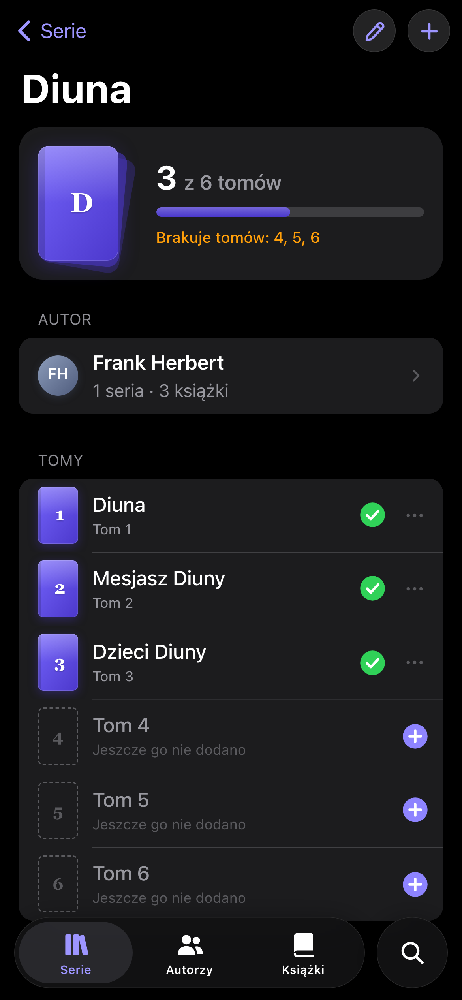
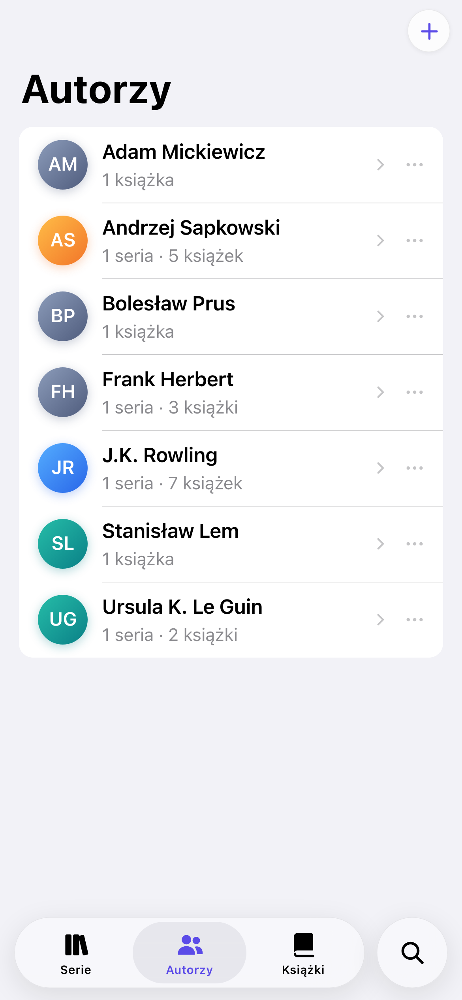

# Biblioteczka dla Home Assistanta

Wspólna domowa biblioteczka dla całej rodziny, działająca w Home Assistancie jako aplikacja
(dawniej „dodatek”). Pilnuje serii i brakujących tomów, a książkę dodaną na jednym telefonie
od razu widać na pozostałych urządzeniach domowników.

## Zrzuty ekranu

Na komputerze: lista po lewej, szczegóły wybranej pozycji po prawej.

  
  

Na telefonie (także w aplikacji Home Assistant na iPhone’a i Androida):

  
  
  

## Co potrafi

- **Serie i brakujące tomy** – które tomy już stoją na półce, których brakuje i ile
  zostało do kompletu.
- **Autorzy, książki i wyszukiwanie** po tytule, autorze i serii (bez względu na polskie
  znaki i wielkość liter).
- **Dodawanie po numerze ISBN** – zeskanuj kod kreskowy aparatem albo ze zdjęcia, a dane
  i okładka uzupełnią się same (Biblioteka Narodowa, e-ISBN, Open Library).
- **Podpowiedzi przy wpisywaniu** i wbudowany katalog stu popularnych bajek i książek
  dla dzieci.
- **Import i eksport CSV**, w tym import pliku z aplikacji Biblioteczka na iPhone’a.
- **Jedna baza dla wszystkich domowników**, zmiany widoczne na każdym urządzeniu.
- Interfejs po polsku, jasny i ciemny motyw, układ dla telefonu, tabletu i komputera
  (na komputerze także obsługa klawiaturą).
- **Dane zostają w domu** – do internetu trafiają wyłącznie numery ISBN wyszukiwanych
  książek.

## Wymagania

- Home Assistant OS (aplikacje są dostępne tylko w tym rodzaju instalacji).
- Procesor 64-bitowy: `aarch64` (np. Raspberry Pi 4/5, Home Assistant Green i Yellow)
  albo `amd64` (komputery i mini PC).

## Instalacja

Najszybciej: kliknij niebieski przycisk powyżej (z angielskim napisem „Add app repository
to My Home Assistant”) – otworzy się Twój Home Assistant z gotowym adresem repozytorium.
Ręcznie:

1. W Home Assistancie otwórz **Ustawienia → Aplikacje** i kliknij **Zainstaluj aplikację**
   (otworzy się **Sklep z aplikacjami**).
2. W menu **⋮** w prawym górnym rogu wybierz **Repozytoria** i kliknij **Dodaj**. W oknie
   dodawania repozytorium wklej w polu **URL** adres
   `https://github.com/Krzychurychu3/biblioteczka-ha`, kliknij **Dodaj** i zamknij okno
   z listą repozytoriów.
3. Odśwież stronę. Na liście pojawi się sekcja **Biblioteczka** – kliknij aplikację
   **Biblioteczka**, a potem **Zainstaluj**. Home Assistant zbuduje ją na Twoim
   urządzeniu; na Raspberry Pi może to potrwać kilka minut.
4. Kliknij **Uruchom** i włącz **Pokaż na pasku bocznym** oraz **Watchdog**.

Biblioteczka pojawi się na pasku bocznym u wszystkich domowników. O nowych wersjach
Biblioteczki Home Assistant powiadomi sam – aktualizacja pojawi się w **Ustawieniach**, jak
przy innych aplikacjach.

Pełna instrukcja – skanowanie kodów, import z iPhone’a, kopie zapasowe, rozwiązywanie
problemów – jest w [dokumentacji](biblioteczka/DOCS.md); Home Assistant pokazuje ją też
na karcie **Dokumentacja** aplikacji.

## Dla programistów

Budowa, uruchamianie lokalne, testy i wydawanie nowych wersji:
[DEVELOPMENT.md](DEVELOPMENT.md).
